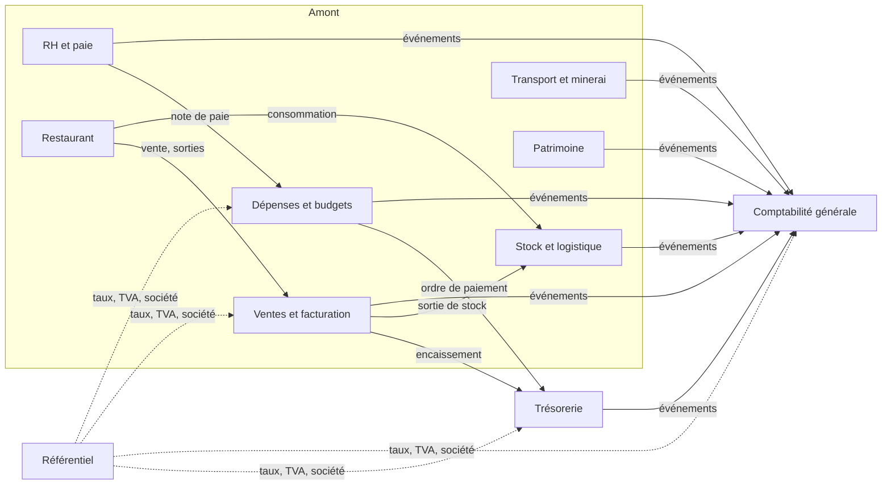
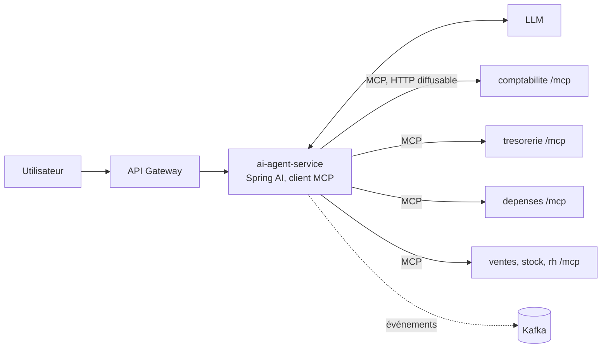

# M-FINAPP — Document d'architecture technique et plan de transition vers les microservices

- **Date** : 10/11/2026 — **Base analysée** : branche `fix/seeder-beneficiaire` (commit `e86be37`), migrations Flyway jusqu'à V134.
- **Statut** : proposition d'architecte, à valider. Aucune ligne de code n'a été modifiée.
- **Source** : le code du dépôt (aucune spécification n'était jointe à la demande) et l'audit SYSCOHADA du module Comptabilité du même jour.

---

## 0. Avis d'architecte avant de commencer

### 0.1 Ce qu'est M-FINAPP aujourd'hui

| Élément | Constat dans le code |
|---|---|
| Forme | Un seul backend Spring Boot 3.3.5 (Java 21), 673 classes, environ 65 000 lignes ; un frontend Nuxt/Vue ; une application de bureau (`frontend-desktop`) |
| Organisation du code | Par couche technique (`controller`, `service`, `repository`, `domain`), pas par domaine : 104 services dans un seul paquet |
| Données | Une base PostgreSQL 16, environ 95 tables, 134 migrations, clés étrangères entre tous les domaines |
| Modules activables | CAISSE, BANQUE, MOBILE_MONEY, COMPTABILITE, BUDGET, RAPPROCHEMENT, VENTES, FACTURATION_NORMALISEE, LOGISTIQUE, TRANSPORT, PATRIMOINE, DRH, plus Restaurant, Minerai et Notes de frais |
| Sécurité | JWT émis par l'application, 13 rôles, grille de droits en base (`role_permissions`), cascade modules → rôles → comptes |
| Déploiement | Docker Compose : `db`, `backend`, `frontend`, `nginx`. Limites actuelles : 1 cœur et 1,5 Go pour le backend, environ 2,25 cœurs et 3 Go au total |
| Particularité | Mode « serveur local maître + serveur en ligne en copie » avec réplication applicative (`journal_replication`, `actions_distantes`) |

### 0.2 Le couplage principal : le grand livre

Dix-neuf services écrivent ou lisent directement le grand livre dans **la même transaction** que leur opération métier : ventes, retours, stock, paie, patrimoine, provisions, transport, minerai, rapprochement, TVA, écarts de change, clôture, import. C'est ce qui garantit aujourd'hui qu'une vente et son écriture comptable existent ensemble ou pas du tout. C'est aussi le nœud que toute la réarchitecture doit dénouer : dans la cible, cette garantie devient une cohérence à terme, obtenue par événements.

### 0.3 Trois réserves à connaître avant de décider

1. **Le dimensionnement.** La cible demandée fait tourner environ 25 conteneurs, dont 13 à 15 machines virtuelles Java, Keycloak et Kafka. Il faut compter 16 Go de mémoire au minimum, 24 à 32 Go pour être à l'aise. Le serveur actuel est réglé pour 3 Go. Le mode « serveur local sur le réseau de l'entreprise » devient lourd à installer chez un client.
2. **L'équipe.** Une plateforme de microservices demande de l'exploitation continue : supervision, traçage distribué, gestion des files en erreur, montées de version coordonnées. Pour une petite équipe, c'est une charge permanente.
3. **Le besoin réel.** Les faiblesses relevées par l'audit (intangibilité des écritures, clôture, séparation des tâches) ne viennent pas du monolithe. Elles se corrigent dedans, et doivent l'être **avant** toute extraction, sinon elles seront copiées dans les nouveaux services.

**Recommandation.** Suivre le plan ci-dessous, mais avec une étape 0 obligatoire : transformer le backend en monolithe modulaire (un module par domaine, frontières contrôlées, événements internes). Cette étape apporte l'essentiel du gain de maintenabilité, coûte peu en exploitation, et rend chaque extraction ultérieure mécanique. On peut s'y arrêter, ou n'extraire que les services qui le justifient. Le reste du document décrit la cible complète demandée.

---

## 1. Découpage métier (Bounded Contexts)

### 1.1 Carte des contextes



La Comptabilité est en **aval** de tout : elle ne commande personne, elle traduit les événements des autres en écritures. Aucun service métier n'appelle plus le grand livre directement.

### 1.2 Services métier

Toutes les bases sont **PostgreSQL 16**, une instance logique par service. Justification : données financières relationnelles, transactions ACID, contraintes d'intégrité, équipe et migrations déjà sur PostgreSQL. MongoDB n'apporte rien ici ; MariaDB imposerait de réécrire 134 migrations sans bénéfice. Les exceptions sont signalées.

| # | Service | Périmètre | Entités propriétaires (tables actuelles) |
|---|---|---|---|
| 1 | `referentiel-service` | Société, établissements, devises et taux de change, taux de TVA, groupes de taxe DGI, activation des modules, papier à en-tête | `parametres_entreprise`, `taux_change`, `taux_tva`, `groupes_taxe_dgi`, `modules_config`, `parametres_instance` |
| 2 | `comptabilite-service` | Plan comptable OHADA, journaux, pièces, grand livre, exercices et périodes, clôture, TVA, analytique (classe 9), règles d'imputation, états financiers, import de reprise | `comptes_ohada`, `pieces_comptables`, `grand_livre`, `parametres_comptables`, `provisions`, `provision_reprises` ; à créer : `exercices`, `periodes`, `regles_imputation` |
| 3 | `tresorerie-service` | Caisse, banque, mobile money, établissements de trésorerie, relevés, rapprochement, écarts de change réalisés | `transactions_caisse`, `transactions_bancaires`, `transactions_mobile_money`, `etablissements_tresorerie`, `releves_bancaires`, `lignes_releve`, `pointages_rapprochement` |
| 4 | `depenses-service` | Notes de frais et leur circuit (BROUILLON → SOUMISE → VERIFIEE_DFIN → VALIDEE_DA → TRANSMISE_CAISSE → PAYEE), retours de fonds, budgets, services budgétaires, seuils de priorité | `notes_frais`, `lignes_note_frais`, `observations_note`, `retours_fonds_note`, `lignes_retour_fonds`, `budgets`, `lignes_budget`, `lignes_budget_mois`, `services_budgetaires`, `parametres_priorite_note` |
| 5 | `ventes-service` | Clients, ventes, retours de vente, créances, balance âgée, facture normalisée (e-MCF) | `clients`, `ventes`, `lignes_vente`, `retours_vente`, `lignes_retour_vente`, `factures_normalisees`, `parametres_emcf` |
| 6 | `stock-service` | Articles, entrepôts, mouvements, lots, niveaux, valorisation, production | `articles`, `entrepots`, `mouvements_stock`, `lignes_mouvement_stock`, `lots_stock`, `lots_stock_consommations`, `stock_niveaux`, `stock_grand_livre`, `productions`, `lignes_production` |
| 7 | `restaurant-service` | Salles, tables, carte, commandes, sorties de plats, boissons et provisions, emballages consignés, péremption | `salles_restaurant`, `tables_restaurant`, `restaurant_*` |
| 8 | `rh-paie-service` | Employés, présences, rotations, sites, ordres de mission, bulletins et paramètres de paie | `drh_*` |
| 9 | `transport-service` | Véhicules, trajets, dépenses de véhicule, camions de minerai, charges et recettes | `vehicules`, `trajets`, `depenses_vehicule`, `camions_minerai`, `charges_camion_minerai`, `modeles_charge_minerai`, `lignes_recette` |
| 10 | `patrimoine-service` | Immobilisations, plans et dotations d'amortissement, cessions, inventaire physique | `immobilisations`, `lignes_amortissement` |

### 1.3 Services transverses

| Service | Périmètre | Stockage |
|---|---|---|
| Keycloak | Identités, mots de passe, rôles, sessions | PostgreSQL dédié |
| `habilitations-service` | Grille de droits par rôle, libellés de rôles, cascade modules → rôles → comptes, préférences utilisateur | PostgreSQL (`role_permissions`, `role_libelles`, `preferences_utilisateur`) |
| `notification-service` | Notifications dans l'application et par courriel | PostgreSQL (`notifications`, `parametres_mail`) |
| `audit-service` | Journal d'audit en ajout seul, chaîné par empreinte ; remplace `audit.log` | PostgreSQL dont le rôle applicatif n'a que `INSERT` et `SELECT` |
| `document-service` | Pièces justificatives, empreinte SHA-256, aucune suppression | Stockage objet (MinIO) + PostgreSQL pour les métadonnées |
| `ai-agent-service` | Agent conversationnel et analyse financière | PostgreSQL (conversations, `parametres_ia`) |

### 1.4 Choix de découpage à assumer

- **Budgets avec notes de frais.** L'engagement budgétaire se décide à la validation d'une note. Les séparer créerait une transaction distribuée à chaque validation, sans gain.
- **Clients avec ventes.** La table `clients` ne sert que les ventes. Un « customer-service » isolé serait un service de trois écrans, appelé en synchrone à chaque vente.
- **Provisions comptables dans la Comptabilité.** Ce sont des écritures d'inventaire, pas un domaine autonome.
- **Patrimoine et Transport** sont de bons candidats à rester regroupés (avec la Comptabilité pour le premier) si l'on veut réduire le nombre de machines virtuelles. Le tableau donne le découpage complet ; un découpage à 7 services est défendable.
- **Références entre services.** Plus aucune clé étrangère entre bases. Un service garde l'identifiant de l'objet distant et, s'il en a besoin pour afficher ou contrôler, une copie locale en lecture seule alimentée par événements (par exemple le numéro et le libellé des comptes dans `depenses-service`).

---

## 2. Architecture technique cible et flux

### 2.1 Socle

Versions de départ : Spring Boot 3.3.x, Spring Cloud 2023.0.x, Java 21.

**API Gateway (Spring Cloud Gateway)**

```yaml
spring:
  cloud:
    gateway:
      default-filters:
        - TokenRelay=
        - RemoveRequestHeader=Cookie
        - name: RequestRateLimiter
          args:
            redis-rate-limiter.replenishRate: 20
            redis-rate-limiter.burstCapacity: 40
            key-resolver: "#{@utilisateurKeyResolver}"
      routes:
        - id: comptabilite
          uri: lb://comptabilite-service
          predicates: [ Path=/api/comptabilite/** ]
        - id: tresorerie
          uri: lb://tresorerie-service
          predicates: [ Path=/api/caisse/**, /api/banque/**, /api/mobile-money/**, /api/rapprochement/** ]
        - id: depenses
          uri: lb://depenses-service
          predicates: [ Path=/api/notes-frais/**, /api/budgets/** ]
        # pendant la migration : tout le reste part vers le monolithe
        - id: monolithe
          uri: http://monolithe:8080
          predicates: [ Path=/api/** ]
          order: 10000
  security:
    oauth2:
      resourceserver:
        jwt:
          issuer-uri: ${KEYCLOAK_ISSUER}
```

Rôle : terminaison de la sécurité côté entrée, validation du jeton, limitation de débit par utilisateur (Redis), CORS, identifiant de corrélation, coupe-circuit (Resilience4j). Les chemins `/api/...` actuels sont conservés : le frontend ne change pas.

**Discovery (Eureka).** Un serveur en développement, deux en production. Chaque service s'enregistre avec `eureka.instance.prefer-ip-address=true`. Sur un seul hôte Docker Compose, le DNS interne de Docker suffirait ; Eureka se justifie dès qu'il y a plusieurs hôtes ou plusieurs instances.

**Config Server.** Dépôt Git **privé** distinct du dépôt public du code, un fichier par service et par profil (`comptabilite-service-prod.yml`). Secrets chiffrés (`{cipher}`) ou sortis vers Vault. Rafraîchissement par Spring Cloud Bus. Chaque service démarre avec `spring.config.import=configserver:`.

**Keycloak**

| Élément | Paramétrage |
|---|---|
| Realm | `mfinapp` |
| Clients | `mfinapp-web` (public, Authorization Code + PKCE), `mfinapp-desktop` (public, PKCE), `ai-agent` (confidentiel, échange de jeton), un client confidentiel par service pour les appels de service à service (client credentials) |
| Rôles de realm | Les 13 rôles actuels : ADMIN, DA, DFIN, DG, COMPTABLE, CAISSIER, LOGISTIQUE, RESP_RESTAURANT, RESP_CUISINE, RESP_BAR, DRH, etc. |
| Identifiant | Nom d'utilisateur ou adresse, casse ignorée (règle actuelle `IdentifiantConnexion`) |
| Mot de passe provisoire | Action requise `UPDATE_PASSWORD` : remplace le blocage `MOT_DE_PASSE_A_CHANGER` |
| Anti-force-brute | Détection native, persistante (le verrou actuel est en mémoire) |
| Double authentification | OTP obligatoire pour ADMIN, DFIN, DA, CAISSIER |
| Jetons | Accès 5 à 15 minutes, rafraîchissement avec rotation |

Chaque service est un serveur de ressources OAuth2 : il valide lui-même le JWT et applique `@PreAuthorize`. La passerelle n'est pas la seule barrière. La grille fine des droits et la cascade des modules restent dans `habilitations-service`, mises en cache par les services et invalidées par événement.

Les règles de séparation des tâches du projet sont portées par des tests dans chaque service concerné : l'ADMIN n'encaisse pas, ne décaisse pas et ne vend pas ; les seuils de priorité appartiennent au seul DA ; le valideur d'une pièce n'est pas son créateur.

### 2.2 Communication synchrone (REST, OpenFeign)

Règle : **le synchrone sert à lire, pas à écrire chez un autre**. Une commande qui modifie deux services passe par événements et saga.

| Service | Points d'entrée principaux | Rôles |
|---|---|---|
| comptabilite | `GET /comptabilite/pieces`, `POST /comptabilite/pieces`, `POST /pieces/{id}/comptabiliser`, `POST /pieces/{id}/annuler`, `GET /grand-livre`, `GET /balance-verification`, `GET /bilan`, `GET /compte-resultat`, `POST /cloture/exercice`, `GET /comptes` | COMPTABLE (saisie), DFIN (validation, clôture proposée), DA ou DG (clôture approuvée) |
| tresorerie | `POST /caisse/encaissements`, `POST /caisse/decaissements`, `GET /caisse/journal`, `POST /banque/operations`, `POST /rapprochement/{id}/valider`, `GET /tresorerie/soldes` | CAISSIER ; rapprochement validé par le DFIN |
| depenses | `POST /notes-frais`, `POST /notes-frais/{id}/soumettre`, `/verifier`, `/valider`, `/transmettre`, `GET /budgets/{id}/execution` | Émetteur, DFIN, DA, CAISSIER |
| ventes | `POST /ventes`, `POST /ventes/{id}/valider`, `POST /ventes/{id}/retours`, `GET /clients`, `GET /creances/balance-agee` | Vendeurs, responsables |
| stock | `GET /articles`, `POST /mouvements`, `GET /stock/niveaux`, `POST /stock/reservations` | LOGISTIQUE |
| referentiel | `GET /taux-change/courant`, `GET /taux-tva`, `GET /societe` | Tous en lecture ; ADMIN en écriture |

Appels Feign admis (lecture, avec délai court, coupe-circuit et valeur de repli) :

- `ventes` → `stock` : disponibilité avant validation d'une vente.
- `depenses` → `referentiel` : taux du jour.
- `ai-agent` → tous, en lecture.

Les services ne s'appellent pas en chaîne de plus d'un niveau.

### 2.3 Communication asynchrone

**Courtier : Apache Kafka (mode KRaft).** Raison : le journal d'événements est conservé et rejouable, ce qui sert trois besoins du projet — reconstruire une vue comptable, prouver l'ordre des faits à un auditeur, et alimenter un serveur local en copie. RabbitMQ est plus léger (environ 200 Mo contre 1 Go) et reste le bon choix si le serveur ne dépasse pas 16 Go ; les contrats d'événements ci-dessous sont les mêmes.

**Enveloppe commune**

```json
{
  "eventId": "0190f3c2-…",
  "type": "VenteValideeEvent",
  "version": 1,
  "occurredAt": "2026-11-10T10:58:25Z",
  "aggregateId": "VTE-2026-000123",
  "acteur": { "id": 231, "roles": ["RESP_RESTAURANT"] },
  "correlationId": "…",
  "payload": { }
}
```

La clé de partition est l'identifiant de l'agrégat : l'ordre est garanti pour un même objet. Les schémas sont versionnés dans un registre.

**Catalogue des événements clés**

| Émetteur | Événement | Consommateurs |
|---|---|---|
| ventes | `ClientCreeEvent`, `VenteValideeEvent`, `VenteAnnuleeEvent`, `RetourVenteAccepteEvent`, `FactureNormaliseeEmiseEvent` | comptabilite, stock, tresorerie, notification |
| depenses | `NoteFraisSoumiseEvent`, `NoteFraisValideeEvent`, `OrdrePaiementEmisEvent`, `RetourFondsDemandeEvent`, `BudgetDepasseEvent` | tresorerie, notification, comptabilite |
| tresorerie | `EncaissementEnregistreEvent`, `DecaissementExecuteEvent`, `DecaissementRefuseEvent`, `RapprochementValideEvent` | comptabilite, depenses, ventes |
| stock | `StockSortiEvent`, `StockEntreEvent`, `StockInsuffisantEvent`, `ProductionTermineeEvent`, `InventaireValideEvent` | comptabilite, ventes, restaurant |
| restaurant | `SortiePlatEnregistreeEvent`, `BoissonOfferteEvent`, `ArticlePerimeEvent` | stock, comptabilite |
| rh-paie | `PaieClotureeEvent`, `OrdreMissionValideEvent` | depenses, comptabilite |
| patrimoine | `ImmobilisationAcquiseEvent`, `DotationCalculeeEvent`, `ImmobilisationCedeeEvent` | comptabilite |
| transport | `DepenseVehiculeValideeEvent`, `RecetteMineraiEnregistreeEvent` | comptabilite, depenses |
| comptabilite | `EcritureComptableValideeEvent`, `EcritureRejeteeEvent`, `PeriodeClotureeEvent`, `ExerciceClotureEvent`, `CompteCreeEvent` | tous (verrou de période), audit, ai-agent |
| referentiel | `TauxChangeModifieEvent`, `ModuleDesactiveEvent` | tous |
| tous | `ActionAuditeeEvent` | audit |

**Le grand livre comme consommateur.** `comptabilite-service` porte une table de **règles d'imputation** : pour chaque type d'événement, les comptes à débiter et créditer (par exemple boisson offerte → 6276.1, boisson périmée → 6031.2, repas du personnel → 6617.1). Les autres services ne connaissent plus aucun numéro de compte. À la réception :

1. contrôle d'idempotence sur `eventId` (table `evenements_traites`, contrainte d'unicité) ;
2. contrôle de la période : si elle est close, l'écriture est rejetée et `EcritureRejeteeEvent` est émis ;
3. création de la pièce équilibrée, numérotée et validée dans une seule transaction ;
4. en cas d'échec technique répété, mise en file d'erreurs et affichage dans un écran « écritures en attente » suivi par le comptable.

Conséquence à accepter : entre une vente et son écriture, il s'écoule de quelques millisecondes à quelques secondes. Un état financier porte donc la mention de sa dernière écriture intégrée, et la clôture exige que la file soit vide.

**Transactional Outbox.** Chaque service écrit son changement métier et l'événement dans la même transaction locale :

```sql
CREATE TABLE outbox (
  id            UUID PRIMARY KEY,
  aggregate_type VARCHAR(60)  NOT NULL,
  aggregate_id   VARCHAR(60)  NOT NULL,
  type           VARCHAR(120) NOT NULL,
  payload        JSONB        NOT NULL,
  occurred_at    TIMESTAMPTZ  NOT NULL DEFAULT now(),
  published_at   TIMESTAMPTZ
);
CREATE INDEX outbox_a_publier ON outbox (occurred_at) WHERE published_at IS NULL;
```

Un relais publie ensuite vers Kafka : Debezium (lecture du journal de PostgreSQL) en cible, ou un simple planificateur avec `SELECT … FOR UPDATE SKIP LOCKED` pour commencer. Livraison au moins une fois, donc tous les consommateurs sont idempotents. Le monolithe possède déjà un mécanisme voisin (`journal_replication`, `audit_a_envoyer`) dont le savoir-faire se réutilise.

**Sagas**

| Processus | Style | Déroulé | Compensations |
|---|---|---|---|
| Paiement d'une note de frais | **Orchestration** par `depenses-service` | 1. note VALIDEE_DA, budget engagé → `OrdrePaiementEmisEvent` ; 2. le caissier exécute dans `tresorerie` → `DecaissementExecuteEvent` ; 3. `comptabilite` écrit (charge / trésorerie) → `EcritureComptableValideeEvent` ; 4. note PAYEE | Décaissement refusé : note remise à TRANSMISE_CAISSE avec motif. Écriture rejetée (période close) : note en état « à régulariser », alerte au DFIN ; le décaissement réel n'est jamais annulé automatiquement, il se corrige par une contre-écriture |
| Vente au comptant | **Chorégraphie** | `VenteValideeEvent` → `stock` sort les articles → `tresorerie` enregistre l'encaissement → `comptabilite` écrit vente, TVA, coût et analytique | `StockInsuffisantEvent` → vente repassée en attente. Le stock est **réservé** avant la validation pour rendre ce cas exceptionnel (règle déjà présente pour les commandes en brouillon) |
| Retour de vente remboursé | Orchestration par `ventes-service` | accord du responsable → remise en stock → décaissement par le caissier → écriture | Refus du caissier : retour laissé « accepté, non remboursé » |
| Clôture d'exercice | **Orchestration** par `comptabilite-service` | 1. pré-clôture : chaque service répond à `ControlePreClotureDemande` (brouillons, paie non clôturée, dotations, rapprochements, file d'événements vide) ; 2. gel des périodes (`PeriodeClotureeEvent`) ; 3. réévaluations et régularisations ; 4. pièce de résultat et à-nouveaux ; 5. `ExerciceClotureEvent` | Un contrôle en échec arrête la saga avant l'étape 2 ; rien n'est à défaire |

Les flux d'argent utilisent l'orchestration : l'état de la saga est lisible dans une table, ce qu'un auditeur peut suivre. La chorégraphie est réservée aux flux simples.

**Intégrité financière : règles non négociables**

- Le grand livre et les opérations de trésorerie sont en **ajout seul** : déclencheurs en base refusant `UPDATE` et `DELETE` sur une ligne validée, rôle applicatif non propriétaire des tables. Toute correction est une contre-passation.
- Numérotation définitive attribuée à la validation, par journal et par exercice, dans la transaction.
- Jamais de transaction distribuée en deux phases ; jamais d'annulation automatique d'un mouvement d'argent réel.
- Un rapprochement quotidien automatique compare les événements émis par chaque service et les pièces créées par la Comptabilité, et signale tout écart.

### 2.4 Observabilité

Traçage distribué (Micrometer Tracing + OpenTelemetry), métriques Prometheus, tableaux Grafana, journaux centralisés (Loki) portant l'identifiant de corrélation. Sans cela, un incident sur une saga n'est pas diagnostiquable.

---

## 3. Couche agentique (AI Agent et MCP)

### 3.1 Position de l'agent



- L'agent est un **service comme les autres**, derrière la passerelle. Il ne possède aucune donnée métier et n'accède à aucune base.
- Chaque microservice expose un **serveur MCP** (Spring AI, `spring-ai-starter-mcp-server-webmvc`) sur un chemin `/mcp` joignable uniquement depuis le réseau interne. Les outils MCP appellent les mêmes services applicatifs que les contrôleurs REST : mêmes règles, mêmes contrôles.
- L'agent agit **au nom de l'utilisateur** : échange de jeton Keycloak (token exchange), le jeton de l'utilisateur est transmis à chaque appel d'outil. L'agent ne peut jamais faire plus que la personne qui lui parle.
- Le fournisseur du LLM est configurable, comme aujourd'hui (`parametres_ia`). Les données envoyées au modèle sont limitées au nécessaire et l'option reste désactivable par l'administrateur.

### 3.2 Outils MCP par service

| Service | Outils de lecture | Outils d'action (toujours soumis à validation humaine) |
|---|---|---|
| comptabilite | `consulter_solde_compte`, `grand_livre_compte`, `balance_verification`, `bilan`, `compte_resultat`, `soldes_intermediaires`, `situation_tva`, `etat_cloture` | `proposer_piece_brouillon`, `lancer_controles_pre_cloture`, `initier_audit_coherence` (équilibre, séquences, pièces sans justificatif) |
| tresorerie | `soldes_tresorerie`, `journal_caisse`, `rapport_caisse`, `ecarts_rapprochement` | aucun : l'agent ne déclenche jamais un mouvement d'argent |
| depenses | `notes_en_attente`, `execution_budget`, `depassements` | `preparer_note_frais_brouillon` |
| ventes | `chiffre_affaires`, `creances_agees`, `fiche_client` | `preparer_relance_client` (brouillon) |
| stock | `niveaux_stock`, `articles_proches_peremption`, `mouvements_article` | `proposer_reapprovisionnement` |
| rh-paie | `effectifs`, `masse_salariale` (agrégats seulement) | aucun |
| ai-agent | `generer_rapport_financier` (assemble les états et produit l'analyse, remplace `AnalyseFinanciereIaService`) | — |

### 3.3 Garde-fous

1. **Lecture par défaut.** Les outils d'action ne créent que des brouillons ou des demandes, qui suivent ensuite le circuit normal (DFIN, DA, caissier). Aucun outil ne comptabilise, ne paie, ne clôture ni ne supprime.
2. **Confirmation explicite** de l'utilisateur à l'écran avant tout outil d'action.
3. **Traçabilité** : chaque appel d'outil produit un `ActionAuditeeEvent` avec l'utilisateur, l'outil, les paramètres et le résultat.
4. **Données reçues = données, pas consignes** : un libellé d'écriture ou un nom de client contenant une instruction ne doit jamais être exécuté. Les résultats d'outils sont transmis au modèle comme contenu non fiable.
5. **Plafonds** : nombre d'appels par conversation, taille des réponses, limitation de débit propre à l'agent sur la passerelle.

---

## 4. Conteneurisation et déploiement

### 4.1 Dockerfile type (multi-étapes, jar en couches)

```dockerfile
# syntax=docker/dockerfile:1.7
FROM maven:3.9-eclipse-temurin-21 AS build
WORKDIR /src
COPY pom.xml .
RUN --mount=type=cache,target=/root/.m2 mvn -B -ntp dependency:go-offline
COPY src ./src
RUN --mount=type=cache,target=/root/.m2 mvn -B -ntp package -DskipTests

FROM eclipse-temurin:21-jre-alpine AS couches
WORKDIR /app
COPY --from=build /src/target/*.jar app.jar
RUN java -Djarmode=tools -jar app.jar extract --layers --launcher --destination extrait

FROM eclipse-temurin:21-jre-alpine
WORKDIR /app
RUN addgroup -S mbsc && adduser -S mbsc -G mbsc
COPY --from=couches /app/extrait/dependencies/ ./
COPY --from=couches /app/extrait/spring-boot-loader/ ./
COPY --from=couches /app/extrait/snapshot-dependencies/ ./
COPY --from=couches /app/extrait/application/ ./
USER mbsc
EXPOSE 8080
ENV JAVA_TOOL_OPTIONS="-XX:MaxRAMPercentage=70 -XX:+UseSerialGC -XX:+ExitOnOutOfMemoryError"
HEALTHCHECK --interval=15s --timeout=3s --start-period=60s --retries=5 \
  CMD wget -qO- http://localhost:8080/actuator/health/readiness || exit 1
ENTRYPOINT ["java", "org.springframework.boot.loader.launch.JarLauncher"]
```

Les couches séparent les dépendances (rarement modifiées) du code : une livraison ne retransmet que quelques mégaoctets. Utilisateur non privilégié, mémoire bornée par le conteneur.

### 4.2 Structure du `docker-compose.yml`

```yaml
name: mfinapp

x-service-java: &service-java
  restart: unless-stopped
  environment: &env-java
    SPRING_PROFILES_ACTIVE: prod
    SPRING_CONFIG_IMPORT: "configserver:http://config-server:8888"
    EUREKA_CLIENT_SERVICEURL_DEFAULTZONE: http://discovery:8761/eureka
    KEYCLOAK_ISSUER: http://keycloak:8080/realms/mfinapp
    SPRING_KAFKA_BOOTSTRAP_SERVERS: kafka:9092
  depends_on:
    config-server: { condition: service_healthy }
    discovery:     { condition: service_healthy }
    kafka:         { condition: service_healthy }
  mem_limit: 512m
  cpus: 0.5

networks:
  frontend-net:              # nginx, frontend, gateway
  backend-net:               # gateway, services, socle, kafka
    internal: true
  db-net:                    # services et leurs bases
    internal: true

volumes:
  pg-comptabilite: {}
  pg-tresorerie: {}
  pg-depenses: {}
  pg-ventes: {}
  pg-stock: {}
  pg-restaurant: {}
  pg-rh: {}
  pg-transport: {}
  pg-patrimoine: {}
  pg-referentiel: {}
  pg-transverse: {}          # habilitations, notification, ai-agent
  pg-audit: {}
  pg-keycloak: {}
  kafka-data: {}
  minio-data: {}

services:
  # ---------- entrée ----------
  nginx:
    image: nginx:1.27-alpine
    ports: ["80:80", "443:443"]
    networks: [frontend-net]
    depends_on: [gateway, frontend]

  frontend:
    image: mbsc/finapp-frontend:${VERSION}
    networks: [frontend-net]

  gateway:
    <<: *service-java
    image: mbsc/finapp-gateway:${VERSION}
    networks: [frontend-net, backend-net]

  # ---------- socle ----------
  config-server:
    image: mbsc/finapp-config-server:${VERSION}
    environment:
      SPRING_CLOUD_CONFIG_SERVER_GIT_URI: ${CONFIG_GIT_URI}
      ENCRYPT_KEY: ${CONFIG_ENCRYPT_KEY}
    networks: [backend-net]
    healthcheck: { test: ["CMD", "wget", "-qO-", "http://localhost:8888/actuator/health"], interval: 10s, retries: 12 }

  discovery:
    image: mbsc/finapp-discovery:${VERSION}
    networks: [backend-net]
    healthcheck: { test: ["CMD", "wget", "-qO-", "http://localhost:8761/actuator/health"], interval: 10s, retries: 12 }

  keycloak:
    image: quay.io/keycloak/keycloak:26.0
    command: start --import-realm
    environment:
      KC_DB: postgres
      KC_DB_URL: jdbc:postgresql://db-keycloak:5432/keycloak
      KC_DB_USERNAME: keycloak
      KC_DB_PASSWORD: ${KEYCLOAK_DB_PASSWORD}
      KC_HOSTNAME: ${KEYCLOAK_HOSTNAME}
      KC_PROXY_HEADERS: xforwarded
      KC_HTTP_ENABLED: "true"
    volumes: ["./keycloak/realm-mfinapp.json:/opt/keycloak/data/import/realm.json:ro"]
    networks: [frontend-net, backend-net, db-net]
    depends_on: [db-keycloak]

  kafka:
    image: apache/kafka:3.8.0
    environment:
      KAFKA_NODE_ID: 1
      KAFKA_PROCESS_ROLES: broker,controller
      KAFKA_LISTENERS: PLAINTEXT://:9092,CONTROLLER://:9093
      KAFKA_ADVERTISED_LISTENERS: PLAINTEXT://kafka:9092
      KAFKA_CONTROLLER_QUORUM_VOTERS: 1@kafka:9093
      KAFKA_CONTROLLER_LISTENER_NAMES: CONTROLLER
      KAFKA_OFFSETS_TOPIC_REPLICATION_FACTOR: 1
      KAFKA_AUTO_CREATE_TOPICS_ENABLE: "false"
    volumes: ["kafka-data:/var/lib/kafka/data"]
    networks: [backend-net]
    healthcheck: { test: ["CMD-SHELL", "/opt/kafka/bin/kafka-broker-api-versions.sh --bootstrap-server localhost:9092 >/dev/null"], interval: 15s, retries: 10 }

  redis:
    image: redis:7-alpine
    networks: [backend-net]

  minio:
    image: minio/minio
    command: server /data
    volumes: ["minio-data:/data"]
    networks: [backend-net]

  # ---------- un service métier et sa base (modèle répété) ----------
  db-comptabilite:
    image: postgres:16-alpine
    environment:
      POSTGRES_DB: comptabilite
      POSTGRES_USER: comptabilite_proprietaire
      POSTGRES_PASSWORD: ${DB_COMPTABILITE_PASSWORD}
    volumes: ["pg-comptabilite:/var/lib/postgresql/data"]
    networks: [db-net]
    healthcheck: { test: ["CMD-SHELL", "pg_isready -U comptabilite_proprietaire -d comptabilite"], interval: 10s, retries: 10 }

  comptabilite-service:
    <<: *service-java
    image: mbsc/finapp-comptabilite:${VERSION}
    environment:
      <<: *env-java
      SPRING_DATASOURCE_URL: jdbc:postgresql://db-comptabilite:5432/comptabilite
      SPRING_DATASOURCE_USERNAME: comptabilite_app      # rôle sans droit de propriété
      SPRING_DATASOURCE_PASSWORD: ${DB_COMPTABILITE_APP_PASSWORD}
    networks: [backend-net, db-net]
    mem_limit: 768m

  # db-tresorerie + tresorerie-service, db-depenses + depenses-service,
  # db-ventes + ventes-service, db-stock + stock-service,
  # db-restaurant + restaurant-service, db-rh + rh-paie-service,
  # db-transport + transport-service, db-patrimoine + patrimoine-service,
  # db-referentiel + referentiel-service : même modèle.

  # ---------- transverses ----------
  audit-service:        { <<: *service-java, image: "mbsc/finapp-audit:${VERSION}",        networks: [backend-net, db-net] }
  notification-service: { <<: *service-java, image: "mbsc/finapp-notification:${VERSION}", networks: [backend-net, db-net] }
  habilitations-service: { <<: *service-java, image: "mbsc/finapp-habilitations:${VERSION}", networks: [backend-net, db-net] }
  document-service:     { <<: *service-java, image: "mbsc/finapp-document:${VERSION}",     networks: [backend-net, db-net] }
  ai-agent-service:
    <<: *service-java
    image: mbsc/finapp-ai-agent:${VERSION}
    environment:
      <<: *env-java
      LLM_API_KEY: ${LLM_API_KEY}
    networks: [backend-net, db-net]
```

Points d'attention :

- **Aucun secret dans le fichier** : tout vient d'un `.env` hors dépôt ou de secrets Docker. Le dépôt est public : ni adresse de serveur ni nom de domaine réel dans les fichiers versionnés.
- **Réseaux** : seuls `nginx` et Keycloak sont joignables de l'extérieur ; `backend-net` et `db-net` sont internes ; une base n'est reliée qu'à `db-net`.
- **Volumes** : un par base, plus Kafka, MinIO et la base d'audit. Les volumes d'audit et de documents ne sont jamais supprimés par un script de mise à jour (règle actuelle du journal d'audit, étendue).
- **Économie de mémoire** : sur un hôte unique, une seule instance PostgreSQL peut héberger une **base et un rôle par service**. L'isolation logique est la même (aucun service ne peut lire la base d'un autre), pour un coût mémoire bien moindre. Le fichier ci-dessus montre la forme stricte demandée.
- **Sauvegardes** : une sauvegarde par base, plus une procédure de restauration cohérente dans le temps. Rétention longue pour la Comptabilité, la Trésorerie, l'audit et les documents (dix ans).
- **Au-delà d'un hôte** : passer à Kubernetes (ou Docker Swarm) quand plusieurs instances ou plusieurs serveurs deviennent nécessaires.

**Budget mémoire indicatif**

| Bloc | Conteneurs | Mémoire |
|---|---|---|
| Services métier | 10 × 512 à 768 Mo | 6 Go |
| Transverses et socle Java (gateway, config, discovery, 5 services) | 8 × 384 à 512 Mo | 3,5 Go |
| Keycloak | 1 | 1 Go |
| Kafka | 1 | 1 à 1,5 Go |
| PostgreSQL (instances séparées) | 13 × 200 à 300 Mo | 3 Go |
| Redis, MinIO, nginx, frontend, supervision | — | 2 Go |
| **Total** | environ 40 conteneurs | **16 à 18 Go** |

---

## 5. Feuille de route de migration (Strangler Fig)

### Étape 0 — Préparer le monolithe (2 à 3 mois) — indispensable

1. **Corriger les constats critiques de l'audit** dans le monolithe : import « Remplacer », clôture réversible et contournable, compte de résultat après clôture, déclencheurs d'intangibilité, traçabilité du valideur. Ces règles seront ensuite emportées telles quelles dans `comptabilite-service`.
2. **Passer du découpage par couche au découpage par domaine** : un paquet par contexte de la section 1, avec Spring Modulith pour vérifier les frontières dans les tests.
3. **Remplacer les appels directs au grand livre par des événements internes** : `StockService`, `VenteService`, `PaieComptabilisationService`, etc. publient un événement ; le module Comptabilité l'écoute et applique la règle d'imputation. Encore dans la même transaction à ce stade.
4. **Introduire la table `outbox`** et l'enveloppe d'événement.
5. **Séparer les schémas** dans la base unique : un schéma PostgreSQL et un rôle par module ; supprimer les clés étrangères entre schémas.
6. **Filet de sécurité** : la suite de tests actuelle, complétée de tests de bout en bout sur les flux d'argent, doit passer à chaque étape.

Critère de sortie : chaque module compile, se teste et accède à ses seules tables. On peut s'arrêter ici avec un système déjà bien plus sain.

### Étape 1 — Socle transverse (1 à 2 mois)

1. Déployer Config Server, Eureka, Kafka, Redis, la supervision.
2. Placer la **passerelle devant le monolithe** : une seule route, tout part vers lui. Aucun changement visible.
3. **Keycloak** : import des comptes et des rôles. Les mots de passe actuels sont hachés en bcrypt, que Keycloak ne vérifie pas nativement : soit un fournisseur de hachage bcrypt ajouté à Keycloak, soit une fédération temporaire vers le monolithe qui migre chaque compte à sa première connexion. Pendant la transition, le monolithe accepte les deux jetons (le sien et celui de Keycloak).
4. Basculer le frontend puis l'application de bureau sur la connexion Keycloak. Retirer ensuite l'émission de jetons du monolithe.
5. Brancher le relais de l'outbox du monolithe vers Kafka.

### Étape 2 — Premier service pilote (1 à 2 mois)

**Pilotes recommandés, dans l'ordre :**

1. `notification-service` et `audit-service` : purement consommateurs d'événements, sans risque financier. Ils valident toute la chaîne (outbox, Kafka, Config, Eureka, sécurité, déploiement).
2. `rh-paie-service` comme premier service métier : ses tables sont déjà isolées (`drh_*`), et son seul lien avec la finance est la note de paie.

« Clients » ou « Facturation » sont de mauvais pilotes ici : `clients` est trop petit pour être un service, et la vente touche le stock, la caisse, la TVA, la facture normalisée et l'analytique à la fois.

Déroulé pour un service : extraire le module, lui donner sa base, router son chemin sur la passerelle, faire tourner en parallèle, comparer, basculer. Retour arrière : remettre la route vers le monolithe.

### Étape 3 — Migration des données et synchronisation temporaire

Pour chaque service extrait :

1. **Copie initiale** du schéma du module vers la nouvelle base (`pg_dump` du schéma, identifiants conservés).
2. **Synchronisation continue** pendant la cohabitation : capture des changements (Debezium) du monolithe vers le service, à sens unique. **Un seul système écrit à la fois** sur une donnée ; pas d'écriture double.
3. **Lecture comparée** : le service répond en parallèle du monolithe, les réponses sont comparées automatiquement, les écarts corrigés.
4. **Bascule** : arrêt bref des écritures sur le module (quelques minutes, hors heures d'activité), dernier rattrapage, contrôle des totaux, changement de route. Le monolithe ne garde qu'une copie en lecture, alimentée par événements, tant qu'il en a besoin.
5. **Contrôles de bascule** propres à la finance : nombre de lignes, sommes des débits et crédits par compte et par mois, soldes de caisse et de banque, numéros de pièces sans blanc.

**Ordre d'extraction conseillé**

| Vague | Services | Raison |
|---|---|---|
| 1 | notification, audit, document | Sans risque, valident le socle |
| 2 | rh-paie, transport, patrimoine | Faiblement couplés |
| 3 | stock, restaurant | Couplés entre eux, à sortir ensemble |
| 4 | ventes | Dépend du stock |
| 5 | depenses, tresorerie | Cœur du circuit de l'argent, sagas d'orchestration |
| 6 | comptabilite, referentiel | En dernier : tous les émetteurs sont déjà des services, il ne reste qu'à déplacer le consommateur |

### Étape 4 — Décommissionnement

1. Le monolithe ne reçoit plus aucune route : le laisser un cycle comptable complet en lecture seule, comme référence de comparaison.
2. Archiver sa base (sauvegarde scellée, conservée dix ans) et le journal d'audit historique.
3. Supprimer le code, les routes de repli et les synchronisations temporaires.
4. Revoir le mode « serveur local » (voir ci-dessous).

**Durée totale réaliste** : 12 à 18 mois pour une petite équipe, en continuant à livrer des fonctions.

### Risques et décisions à prendre

| Sujet | Risque | Décision attendue |
|---|---|---|
| Serveur | La cible ne tient pas sur l'infrastructure actuelle | Budget pour un serveur de 16 à 32 Go, ou cible réduite à 6 ou 7 services |
| Mode serveur local | La réplication applicative actuelle ne se transpose pas à 13 bases | Soit installer toute la pile sur le serveur local, soit garder une édition monolithique pour les sites locaux, soit abandonner ce mode au profit d'une connexion fiable |
| Cohérence à terme | Un état financier peut précéder de quelques secondes une opération | Accepté par la direction financière ; file vide exigée à la clôture |
| Application de bureau | Dépend de l'API et de l'authentification actuelles | À migrer vers Keycloak à l'étape 1 |
| Exploitation | Pas de supervision aujourd'hui | Une personne formée et des alertes avant la vague 2 |
| Arrêt à l'étape 0 | — | Option légitime : à réévaluer à la fin de l'étape 0, sur des critères mesurés (délais de livraison, charge, incidents) |
